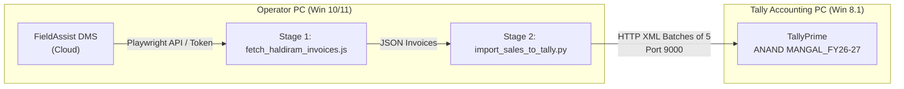

# Complete Haldiram DMS to TallyPrime Automation Guide

This document is the definitive master manual for the Haldiram FieldAssist DMS to TallyPrime integration for **ANAND MANGAL** (`ANAND MANGAL_FY26-27`).

---

## 1. System Architecture: Where Everything Runs

> [!IMPORTANT]
> **DO NOT install or run these scripts on the Windows 8.1 Tally PC (`192.168.10.110`).**
> - Windows 8.1 cannot run modern Node.js or Playwright/Chromium.
> - **The Tally PC requires NO code, NO Python, and NO Node.**
> - The scripts run on a modern Windows 10/11 laptop (Operator PC) and push XML data over the network via HTTP to Tally's port 9000.



---

## 2. Setting Up a New Operator PC (If Moving to Another Laptop)

If you are setting this up on a new Windows 10/11 laptop:

### Step 1: Install Required Software
1. **Python 3.10+**: Download from [python.org](https://www.python.org). Check "Add Python to PATH" during installation.
2. **Node.js LTS (v18+)**: Download from [nodejs.org](https://nodejs.org).
3. **Google Chrome**: Ensure Google Chrome is installed.

### Step 2: Extract Zip & Install Dependencies
Open PowerShell or Command Prompt in the project folder and run:
```bash
# Install Python packages
pip install requests

# Install Node packages
npm install playwright

# Install browser binaries for Playwright
npx playwright install chromium
```

*(Note: Never zip or transfer `node_modules`. Always run `npm install` on the target machine).*

---

## 3. One-Time Login (FieldAssist Session Setup)

FieldAssist uses authentication tokens stored in `auth.json`. Whenever a new setup is done, or if the token expires:

1. Double-click or run:
   ```bash
   node save_login.js
   ```
2. A Chrome browser window will open automatically to `https://dms-hsfpl.fieldassist.io/`.
3. Enter the username and password and click **Log In**.
4. Once you reach the main dashboard screen (`/home`), wait 3 seconds.
5. The script will save your active tokens into `auth.json` and automatically close Chrome.
6. You will see:
   ```text
   🎉 Session & tokens saved successfully to: auth.json
   ```

---

## 4. Daily Operations (How to Run the Sync)

### Method A: The 1-Click Desktop Shortcut (Recommended for Staff)
1. Ensure TallyPrime is open on the Tally PC (`192.168.10.110`) with company **`ANAND MANGAL_FY26-27`** active.
2. Double-click the desktop shortcut: **`Haldiram Bills Sync`** (or run `START_DAILY_SYNC.bat`).
3. The prompt asks:
   - Press **ENTER** directly to sync **TODAY's** invoices.
   - OR type a specific date in `DD-MM-YYYY` format (e.g., `05-10-2026`).
4. The system executes both stages automatically:
   - **Stage 1**: Downloads line-item invoices from FieldAssist into `invoices/`.
   - **Stage 2**: Checks deduplication, creates any missing customers/items, and pushes vouchers in batches of 5 to Tally.

### Method B: Date Range Sync (For Multiple Days / Backlog)
Run via PowerShell/Terminal:
```bash
# Sync all days from Oct 11 to Oct 28:
python sync_date.py 11-10-2026 28-10-2026
```

---

## 5. Technical Pipeline & Safety Architecture

### A. Deduplication Engine (Zero Duplicate Risk)
Before sending any voucher to Tally:
1. `import_sales_to_tally.py` queries Tally's `Voucher` collection on port 9000 for all existing `REFERENCE` and `VOUCHERNUMBER` entries.
2. If an invoice number already exists in Tally, it is automatically segregated into `already_in_tally/already_in_tally_<date>.json`.
3. Only clean, unimported invoices proceed to Tally.

### B. Master Auto-Creation
Before pushing vouchers, the script automatically parses all buyers and stock items:
- **Customers**: Auto-created under group `Sundry Debtors` with State, Address, and Pincode.
- **Stock Items**: Auto-created under Stock Group `Haldiram` with Base Unit `PCS`.

### C. Safe Batching (5 Vouchers Per Request)
Sending large volumes (50-100 vouchers) in a single XML causes Tally's internal XML parser to trigger a `c0000005 Memory Access Violation`. The pipeline splits all vouchers into batches of **5**, sleeping 0.5s between batches.

### D. Default IP & Ports
In `import_sales_to_tally.py`, the default destination IP is:
- `--tally-ip 192.168.10.110` (Port `9000`)
- Target Company: `ANAND MANGAL_FY26-27`
- Sales Ledger: `Sales - Haldiram`

---

## 6. TallyPrime Configuration on Windows 8.1 Machine

On the accounting PC (`192.168.10.110`):
1. **Open TallyPrime**.
2. Press **`F1` (Help) $\rightarrow$ `Settings` $\rightarrow$ `Connectivity` $\rightarrow$ `Client/Server configuration`**:
   - **TallyPrime acts as**: `Both` (or `Server`)
   - **Enable ODBC**: `Yes`
   - **Port**: `9000`
3. Load the company: **`ANAND MANGAL_FY26-27`**.
4. **Firewall**: Ensure Windows Firewall permits incoming TCP port 9000 connections.

---

## 7. Troubleshooting & Failure Diagnostics

| Symptom / Error | Root Cause | Solution |
| :--- | :--- | :--- |
| `SyntaxError: Unexpected token 'U', "Unauthorized"...` | FieldAssist session in `auth.json` expired. | Run `node save_login.js` and log in again. |
| `Connection refused` or `Read timed out` on port 9000 | Tally is closed or port 9000 is disabled. | Check if Tally is running on `192.168.10.110` and port 9000 is listening. |
| `Remote end closed connection without response` | Tally crashed or is stuck on "Select Company" screen. | Open Tally and make sure company `ANAND MANGAL_FY26-27` is actively loaded. |
| `Cannot delete unnamed object: VOUCHER!` | Missing `TAGNAME="VoucherNumber"` during delete action. | Handled automatically by the script. |
| `Total Fetched=N \| Already in Tally=N \| New to Import=0` | All invoices for this date are already in Tally. | No action needed; duplicate prevention did its job. |
